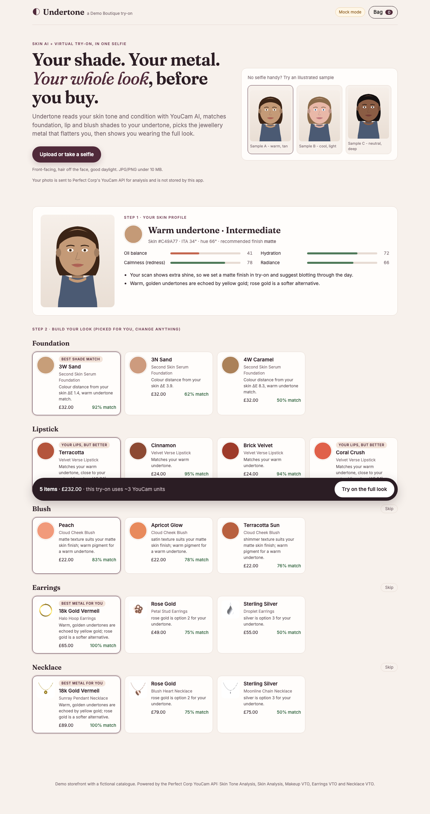

# Undertone: skin-aware beauty and jewellery try-on

> One selfie in. Out come your foundation shade, your lip and blush colours, the jewellery metal that suits you, and a photo of you wearing the whole look. Built on the Perfect Corp **YouCam API**.

Entry for the [YouCam API Skin AI & eCommerce VTO Hackathon](https://youcam-api-skin-ai-ecommerce.devpost.com/). Topics: **Skin AI** and **eCommerce VTO** (Beauty + Jewellery).



## The problem

Shoppers buying complexion makeup and jewellery online are guessing. Foundation shade and undertone are the hardest to judge from a product photo, so wrong shades get returned. Jewellery metal (gold or silver) depends on the same undertone, but stores sell it in a separate aisle with nothing joining it to the shopper's skin. Most virtual try-on tools do one product at a time and leave the shopper to work out what to try.

## What Undertone does

1. **Read the skin (Skin AI).** The selfie goes to two YouCam APIs at the same time:
   - **AI Skin Tone Analysis** gives skin, lip, eye and hair colours.
   - **AI Skin Analysis (SD)** scores oiliness, moisture, redness and radiance.
2. **Turn it into a profile.** Undertone converts the skin colour to CIELAB. The **hue angle** gives the undertone (cool, neutral or warm). The **ITA°** (Individual Typology Angle, a dermatology scale) gives skin depth. The skin scores set the **finish** (matte, satin or dewy), the **coverage** and the **glow**.
3. **Recommend across categories.** Using that profile, Undertone ranks:
   - foundation shades by **CIEDE2000 ΔE**, plus a penalty when the undertone doesn't match;
   - lipsticks, with a "your lips, but better" badge for shades close to the user's natural lip colour as YouCam measured it;
   - blush, matched to undertone and finish;
   - **earrings and necklaces by metal**: gold for warm, silver for cool, rose gold for neutral.

   Every pick shows a plain-English reason and a match score.
4. **Try on the whole look in one image (eCommerce VTO).** The YouCam calls run in a chain:

   **Makeup VTO** (foundation + blush + lipstick) → **Earrings VTO** → **Necklace VTO**

   Each step uses the previous step's result URL as its source. The skin scan's finish, coverage and glow are passed straight into the makeup-vto foundation effect. Shoppers see a before/after slider, then add the whole look to the bag in one tap.

### YouCam APIs used

| Feature | Endpoint | Units* |
|---|---|---|
| File upload | `POST /s2s/v2.0/file` → `PUT` pre-signed URL | 0 |
| AI Skin Tone Analysis | `POST/GET /s2s/v2.0/task/skin-tone-analysis` | 20 |
| AI Skin Analysis (SD, 4 concerns, `format: json`) | `POST/GET /s2s/v2.0/task/skin-analysis` | 9 |
| AI Makeup VTO (foundation, blush, lip_color) | `POST/GET /s2s/v2.0/task/makeup-vto` | 1 |
| AI Earrings VTO | `POST/GET /s2s/v2.0/task/2d-vto/earring` | 1 |
| AI Necklace VTO | `POST/GET /s2s/v2.0/task/2d-vto/necklace` | 1 |

\*Unit costs as published on docs.perfectcorp.com in October 2026. A full scan plus try-on costs about 32 units, and trying on another look in the same session costs about 3.

Request bodies follow Perfect Corp's published OpenAPI specs (`docs.perfectcorp.com/_bundle/reference/*.json`). The client is in `server/youcam/client.ts`.

## Quick start

Requires Node 20 or later.

```bash
npm install
npm run dev          # API on :8787 + web on http://localhost:5173
```

**No API key? It still works.** Without `YOUCAM_API_KEY`, the server runs in **mock mode**. A built-in emulator of the YouCam REST API (`server/youcam/mockFetch.ts`) plugs into the real client as its `fetch`, so the upload, create-task and poll steps all run unchanged. The three illustrated sample avatars (not real people) give three different skin stories:

- A: warm, oily
- B: cool, redness
- C: neutral, dry

**Live mode:**

```bash
cp .env.example .env     # then set YOUCAM_API_KEY=...
npm run dev
# Optional one-shot check of the real API with your own selfie (~32 units):
npm run smoke:live -- ./my-selfie.jpg
```

The API key stays on the server: the browser only talks to `/api/*`, and the key is never sent to the pre-signed upload URL. Uploaded photos are kept in memory only, for the YouCam call. YouCam keeps result files for a limited time; result URLs are valid for 2 hours.

**Production:** `npm run build && npm start` serves the built client and API from one Node process on `$PORT`.

## Scripts

| Command | What it does |
|---|---|
| `npm run dev` | API (tsx watch) + Vite dev server with proxy |
| `npm test` | Vitest: colour science, profile rules, recommender, YouCam client, HTTP API end-to-end in mock mode |
| `npm run typecheck` | `tsc --noEmit` across client, server, shared and tests |
| `npm run build` / `npm start` | Production build and serve |
| `npm run assets` | Regenerates the jewellery product PNGs (drawn from code, so there are no image-rights issues) |
| `npm run smoke:live -- selfie.jpg` | Runs the full pipeline against the real YouCam API |

## Architecture

```
src/            React (Vite) storefront: upload/camera, profile, shelves, try-on, bag
server/
  app.ts        Express routes: /api/analyze, /api/tryon, /api/jobs/:id, catalogue, samples
  pipeline.ts   Orchestration: parallel skin scans, chained VTO job with per-step progress
  youcam/       Typed YouCam client (upload, create, poll, errors, timeouts) + mock emulator
shared/         Pure logic shared by client and server
  color.ts      sRGB to CIELAB, CIEDE2000 (tested against Sharma et al. reference pairs), ITA, LCh
  profile.ts    YouCam results to undertone, depth, finish, coverage, glow, tips
  recommend.ts  Ranking + explanations across foundation/lip/blush/earrings/necklace
  makeup.ts     Builds the makeup-vto `effects` payload
  catalog.ts    Fictional "Demo Boutique" catalogue (foundation shades defined in LCh)
public/products Generated jewellery PNGs (uploaded to YouCam as VTO reference images)
```

The try-on runs as an async job. `POST /api/tryon` returns a job id, and the UI polls `/api/jobs/:id` to show which step is running ("Applying your makeup…", "Fitting Halo Hoop Earrings…").

## Notes and limits

- Undertone thresholds are calibrated against our own shade range and are a styling heuristic, not a medical assessment. Skin scores are for cosmetic guidance only.
- Jewellery VTO works best with a front-facing photo where the ears and neck are visible. Earrings default to the right ear.
- The catalogue, brand names and prices are fictional. Product images are generated by `scripts/generate-assets.mjs`.

## License

MIT. See [LICENSE](LICENSE).
